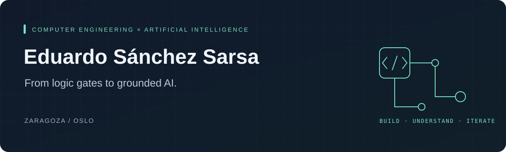

  

  <a href="https://github.com/EduSS282/TaxNorwayRAG">Current project</a> ·
  <a href="https://www.linkedin.com/in/eduardosanchezsarsa">LinkedIn</a> ·
  <a href="mailto:eduardo.sanchezsarsa@gmail.com">Say hello</a>

### Hi, I'm Eduardo.

I study **Computer Engineering at the University of Zaragoza** and **Artificial Intelligence at Kristiania in Oslo**. My projects span hardware, web applications and AI systems — I like understanding what happens underneath the interface as much as building the interface itself.

Lately, I've been exploring a question: **how do you make an AI answer worth trusting?** My current project turns that question into code: retrieval, source evidence, citations and explicit handling of uncertainty.

### On my workbench

#### 01 / Grounded AI · [TaxGuide Norway](https://github.com/EduSS282/TaxNorwayRAG)

A local-first RAG system for exploring official Norwegian tax information. It brings together document acquisition, hybrid retrieval, reranking and answers with validated citations and tax-year checks.

The interesting part: deciding when the available evidence supports an answer, when to ask for clarification and when to abstain. **Research preview; evaluation is ongoing.**

`Python` `FastAPI` `Qdrant` `Next.js` `Local models`

[Explore the project →](https://eduss282.github.io/TaxNorwayRAG/) · [Read the architecture →](https://github.com/EduSS282/TaxNorwayRAG/blob/main/docs/architecture.md)

#### 02 / Collaborative software · Tale of Recognition

A team-built online game inspired by Dixit. I contributed across the web frontend and backend repositories, working on a project that connects a web client, a REST API and real-time communication.

`TypeScript` `Web development` `Team collaboration`

[Frontend →](https://github.com/Unizar-30226-2026-11/Frontend) · [Backend →](https://github.com/Unizar-30226-2026-11/Backend)

#### 03 / Under the hood · Computer architecture

VHDL projects from my computer architecture coursework, including a cache-focused team project. A different scale of engineering: reasoning about how the machine works beneath the software.

`VHDL` `Computer architecture` `Cache`

[Cache project →](https://github.com/Azzal-e/Proyecto2_AOC2) · [Architecture project →](https://github.com/EduSS282/Proyecto1_AOC2)

### The thread connecting it all

| Area | What draws me in |
| :--- | :--- |
| **AI & retrieval** | Connecting generated answers to evidence you can inspect. |
| **Software systems** | Making the pieces work together, from API to interface. |
| **Computer architecture** | Understanding the mechanisms behind the abstractions. |

  
<strong>En español</strong> · Un poco sobre mí

Soy Eduardo, estudiante de Ingeniería Informática en la Universidad de Zaragoza y de un máster en Inteligencia Artificial en Kristiania, Oslo.

Mis proyectos van desde arquitectura de computadores con VHDL hasta aplicaciones web y sistemas de IA. Ahora estoy trabajando en **TaxGuide Norway**, un sistema RAG sobre información fiscal oficial noruega, con especial atención a las fuentes, las citas y la incertidumbre de las respuestas.

Me interesa entender cómo funcionan las cosas por dentro y convertir ese conocimiento en proyectos que se puedan usar, inspeccionar y mejorar.

---

Have a project involving **AI, retrieval or web systems**? [Let's talk.](https://www.linkedin.com/in/eduardosanchezsarsa)
